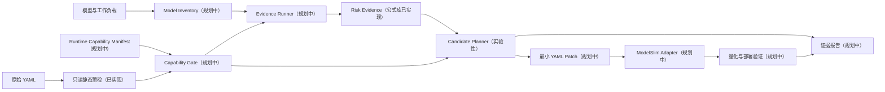

# QuantPlan 目标架构与能力边界

> 状态说明：本文保留了早期 Risk/W4A4 研究架构；当前可执行 P0 合同以 README 为准，使用候选相关的整模型 ΔNLL 并仅支持 W4A8/W8A8/BF16。

## 1. 架构目标

目标产品将“分析证据”“计划决策”和“量化执行”分离：

1. 自有分析核心产生 Risk 和可复现证据；
2. 自有规划层在明确约束下产生候选计划；
3. ModelSlim 仅作为一个可替换执行后端，通过公开 YAML、CLI 和文件产物交互；
4. 任何后端不支持、语义未知或验证不足的状态都必须显式暴露。

当前仓库只实现 Risk 数学函数、实验性成本约束搜索、排序点指标和 ModelSlim YAML
静态策略预检。图中其他节点是立项目标，不是现有产品能力。

## 2. 核心领域对象

### 2.1 Model Inventory

模型清单定义稳定的量化单元标识、结构类型、父子关系和不可量化区域。量化单元必须是后端真实可切换精度的边界，而不是仅为分析方便任意切分的模块名。

Qwen3.5-35B P0 中：

- 决策单元为 40 个语言 Block；
- Gated DeltaNet Block 与 Gated Attention Block 保留结构标签；
- 一个 Block 内 routed experts 与 shared expert 作为同一个决策组；
- router 权重、router logits 和 top-k 路由路径固定为高精度；
- Vision、视觉投影、MTP 和 C4 不进入模型清单的候选空间。

如果 ModelSlim 无法表达这些边界，状态是 `BACKEND_CAPABILITY_BLOCKED`，不能退化为近似 YAML 后继续执行。

### 2.2 Quantization Candidate

候选项描述完整量化语义，而不只是一个位宽字符串，包括：

- weight/activation precision；
- 动态或静态量化；
- granularity、group size、对称性和量化方法；
- include/exclude 范围；
- runner、导出格式与推理引擎约束；
- 候选语义的来源版本。

`W4A8` 与 `W4A4` 的权重均为 4 bit。两者混配验证的是激活精度分配，其成本预算应基于激活流量、active FLOPs 和实测内核性能，不能用模型文件大小或 Block 数量代替。

### 2.3 Risk Evidence

Risk 的正式语义为：

> 在给定模型、量化候选、数据样本、分析器版本和运行条件下，用于确定进一步验证优先级的相对证据信号。

Risk 不是：

- `ΔNLL` 的预测值；
- 下游准确率下降的概率；
- 真实硬件延迟或吞吐损失；
- 单元间可加的损失函数；
- 可跨模型、跨数据集直接比较的绝对分数。

首版主 Risk 使用对角梯度加权相对残差失真。对参考残差流 `h`、候选 fake-quant 残差流 `h_q`、梯度 `a = dL/dh` 和扰动 `δ = h_q - h`，每个 prompt 计算：

\[
N = \sum a^2\delta^2, \qquad
D = \sum a^2h^2, \qquad
S = \frac{N}{D + \epsilon}
\]

其中 `S` 是用于排序的局部相对失真证据。实现还保留 signed first-order term、cross-term diagnostic、未加权 residual relative MSE 和低分母告警，用于解释 `S` 何时可能不稳定。该对角形式丢弃跨坐标项，且有限量化扰动未必处在 BF16 anchor 的局部线性区域，因此 `S` 不能标注或回归解释为 `ΔNLL`。

每条 Risk 记录至少携带：

- model revision 与 quantization candidate ID；
- quant unit ID；
- 数据集和样本组 hash；
- 分析器名称、版本和参数；
- 原始信号、归一化方式和排序；
- capability manifest ID；
- 时间戳和随机种子。

独立的 `ΔNLL`、KL、任务指标和实机结果属于 validation evidence。报告可以展示 Risk 与 validation evidence 的相关性，但不能把两者混为同一字段。

### 2.4 Candidate Plan

规划层根据 Risk、成本预算、固定高精度区域和后端能力生成多个候选，而不是未经验证地选择“最优解”。候选计划必须包含：

- 量化单元到候选量化语义的完整映射；
- 预算口径和预估成本；
- 使用了哪些证据以及哪些证据缺失；
- 被锁定、排除或后端不支持的区域；
- 尚需完成的 validation gates。

当前 gain-per-cost 搜索只比较同一决策组内不同精度的 Risk 差，并用显式成本上限约束
升级。输出中的 `proposal_score` 是未校准的聚合排序辅助量，不是可加的模型损失，
也不作为 Risk 硬门槛。

## 3. Capability Manifest

目标 runtime capability manifest 是所有分析和补丁生成的前置条件。它至少声明：

- ModelSlim、CANN、驱动、推理引擎与硬件版本；
- model type 和 model revision；
- 已支持量化模式及验证等级；
- 可混配的量化单元和必要耦合关系；
- 高精度锁定范围；
- 可编辑 YAML 路径；
- runner、quantizer、saver 和输出格式约束；
- 已知的 kernel fallback 或 precision conversion；
- 未知字段策略。

当前 CLI 使用的 `modelslim-v1-schema-prototype` 只是内容寻址的保守静态字段清单。
它不绑定模型 revision、Transformers、ModelSlim、CANN、推理引擎或硬件，因此预检
通过后的 `execution_readiness` 仍为 `not_assessed`。

能力状态定义：

| 状态 | 含义 | 规划行为 |
| --- | --- | --- |
| `SUPPORTED_VERIFIED` | 已在完全匹配的版本与场景验证 | 可进入正式候选 |
| `SUPPORTED_EXPERIMENTAL` | 能执行但缺少完整稳定性或效果验证 | 仅可进入显式实验候选 |
| `KNOWN_UNSUPPORTED` | 明确不能表达或执行 | 拒绝计划 |
| `UNKNOWN` | 未声明或无法探测 | fail-closed |
| `OUT_OF_SCOPE` | 当前实验主动排除 | 不进入候选空间 |

P0 中不能给笼统的“Qwen3.5-35B W8A8”直接标记
`SUPPORTED_VERIFIED`。ModelSlim 当前已有的实践只证明固定版本下能够生成一份
**部分量化**的 W8A8 权重：主要覆盖 self-attention（排除部分投影）和 routed
experts，并排除 vision、linear-attention 的部分路径与 MTP。Capability manifest
必须以精确 recipe 和覆盖矩阵为单位声明能力；实际加载、内核命中和端到端部署仍需
smoke test。W4A8、W4A4 和 Block 混配只有通过 smoke test 后才能从 `UNKNOWN`
提升为 `SUPPORTED_EXPERIMENTAL`。C4 固定为 `KNOWN_UNSUPPORTED`/`OUT_OF_SCOPE`。

## 4. YAML 处理协议（目标能力）

当前实现只读取原始字节、记录 SHA256、分类字段并检查一部分固定版本语义；不生成
衍生 YAML。以下补丁与无损要求属于后续 patcher 的验收协议。

### 4.1 原文件不可变

原 YAML 是 source of truth：

- 保存原始字节和 checksum；
- 不对原文件原地写入；
- 未来 derived YAML 必须能追溯到原文件和补丁；
- 未来默认输出路径级 patch/diff，而不是重新序列化整份 YAML。

### 4.2 字段所有权

只有 capability manifest 中声明为 `owned_paths` 的路径可由 QuantPlan 修改。P0 预期只拥有与 Block 精度 mask、`include`/`exclude` 或其等价显式配置有关的路径。

以下内容默认不属于 QuantPlan：

- runner 与调度方式；
- calibration dataset；
- saver 与导出格式；
- 自定义 processor；
- 未声明扩展字段；
- 模型加载和安全选项。

### 4.3 未知字段

未知字段采用“原始输入不改、路径锁定、默认不执行”的组合策略：

1. 当前保留原始文件字节、字段路径和 checksum，不重写节点；
2. Risk 分析不得推断未知字段的含义；
3. 补丁不得覆盖未知节点或其父级容器；
4. 未知字段可能影响量化语义时，计划状态为 `YAML_UNKNOWN_FIELD_BLOCKED`；
5. 不允许因为后端可能接受该字段而自动放行；
6. 后续若允许原生透传，结果只能标记为 `UNVERIFIED_PASSTHROUGH`，不能进入正式推荐。

已知但未支持的字段与未知字段同样不能静默忽略。例如 P0 输入出现 C4 配置时，应返回 `KNOWN_UNSUPPORTED`，而不是删除 C4 后继续运行。

### 4.4 最小补丁（规划中）

补丁必须满足：

- 只包含计划实际改变的路径；
- 未修改字段在语义和文本层面尽量保持不变；
- 不丢失自定义字段、anchor、alias、注释或排序；
- 补丁应用前校验原 YAML checksum；
- 冲突、版本漂移或锁定路径重叠时中止。

## 5. ModelSlim Adapter（规划中）

ModelSlim Adapter 仅依赖公开契约：

- CLI 参数；
- YAML 配置协议；
- 权重和日志文件；
- 推理引擎可观察结果。

核心域不得依赖 ModelSlim 内部 `core`、`infra`、`analyze` 或 `tune` 实现。适配器需要：

- 探测并记录版本；
- 校验输入与 capability manifest 一致；
- 捕获量化、加载、部署和 kernel fallback；
- 禁止把后端自动降级后的运行标记为成功验证；
- 输出结构化执行记录供 evidence store 使用。

## 6. 失败状态

以下状态互不替代：

| 状态 | 含义 |
| --- | --- |
| `BACKEND_CAPABILITY_BLOCKED` | 后端无法表达或执行所需精度/粒度 |
| `YAML_UNKNOWN_FIELD_BLOCKED` | 未知字段可能影响语义 |
| `EVIDENCE_INSUFFICIENT` | Risk 或验证样本不足以支持结论 |
| `SEARCH_SPACE_NO_HEADROOM` | 即使 marginal oracle 也不优于对照 |
| `RISK_VALIDATION_FAILED` | Risk 与独立真值不相关或不稳定 |
| `PLAN_VALIDATION_FAILED` | Risk 排序有效，但组合计划未通过质量门禁 |
| `HARDWARE_VALUE_FAILED` | 质量可接受，但实机无可测量收益 |

后端阻塞不能记为算法失败；算法相关性通过也不能替代计划和硬件验证。

## 7. 目标产物

- `capability-manifest.yaml`：版本化能力声明；
- `model-inventory.json`：量化单元及锁定范围；
- `risk-evidence.jsonl`：Risk 原始证据；
- `candidate-plan.json`：候选映射和预算；
- `plan.patch.yaml`：相对原 YAML 的最小补丁；
- `validation-report.json`：ΔNLL、KL、任务指标和实机结果；
- 人类可审阅报告：结论、适用条件、冲突证据和未完成门禁。
